# ALLMIND

让角色住在桌面上，也让相处留下可以查证的记忆。

ALLMIND 是一个 Windows 桌面角色陪伴与本地知识管理项目。你可以创建角色、补充人设与世界观，通过 API 或 ChatGPT 网页聊天，再把资料整理成带来源的 Wiki，并查看知识之间的关系。

**0.1.0-beta.2 · 开发预览版** · Windows x64 · WPF 桌宠 + 本地后台 + Web 管理界面

[快速开始](#快速开始) · [Wiki 与图谱](#wiki-与图谱) · [模型连接](#模型连接) · [已知限制](#已知限制与验证范围) · [后续更新](#后续更新)

## 桌面上的陪伴

基于 GPT-Niang 的 WPF 桌宠底座，接入 ALLMIND 的角色、聊天、预设与记忆能力。

| 点击桌宠，显示回复 | 点击气泡，直接输入 |
| :---: | :---: |
|  |  |

上图由当前生产 WPF 控件渲染，示例文字用于展示布局，**不是桌面实机截图或真实模型回复**。形象来自 [GPT-Niang](https://github.com/T7moris/GPT-Niang)，适用独立的[非商业素材声明](windows/code/desktop-pet/desktop/wpf/shell/assets/CHARACTER-NOTICE.txt)。

- 单击桌宠先看最近回复；没有回复时显示简短招呼。再点气泡进入输入态，发送后在同一气泡显示回复。
- 气泡单独使用短回复指令，目标 40～80 字、要求不超过 120 字，不修改完整聊天的角色预设与长度设置。气泡随内容分档放大；模型超长时显示预览和“展开完整回复”，全文仍保存在聊天中，不自动重发来压缩。
- `Enter` 发送，`Shift+Enter` 换行，`Esc` 返回回复，`×` 收起，`↗` 打开完整聊天。
- 空闲约 15 秒收起；聚焦且有草稿或正在等待回复时保持打开，回复完成后约 30 秒收起。失败保留草稿，不自动重发。
- 点击音效按“按下 → 松开”顺序完整播放；快速连点合并音效反馈，不打断当前一组或积压播放。静音、免打扰或隐藏桌宠会停止声音。
- 支持拖动、缩放、按压反馈与托盘驻留。右键桌宠进入聊天、角色、记忆或设置；托盘右键“退出 ALLMIND”才结束后台。

全新安装带有 **GPT 龙娘初始角色与静态形象**，人设、Wiki 和陪伴记录为空，等待你补充。已有实例不会被初始角色覆盖。截图中的演示资料不随首次启动导入。

## 管理界面

新版界面采用纸白／墨黑与黄色操作提示，统一聊天、角色、记忆和设置的布局，支持浅色、深色、窄屏与减少动效。字体随应用本地加载，无需访问外部字体服务。

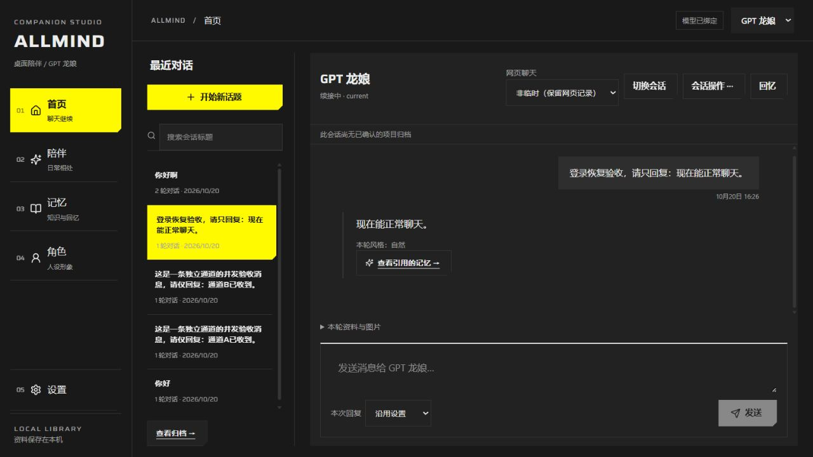

本页界面图于 **2026-10-22** 从隔离实例重新截取，拍摄早于本轮屏幕图片附件功能，尚未补拍该功能截图。聊天与 Wiki 使用明确标注的演示设定和受控回复（fixture），展示操作流程，**不作为真实模型能力的验收证据**；没有配置真实 Key、账号或私人资料。截图中的资料不随首次启动导入。

<details>
<summary>查看角色、模型配置与知识库界面</summary>

以下页面来自同一个演示实例，展示角色、场景配置与知识页入口。

**角色**：新增角色、编辑资料、补充人设和外观。

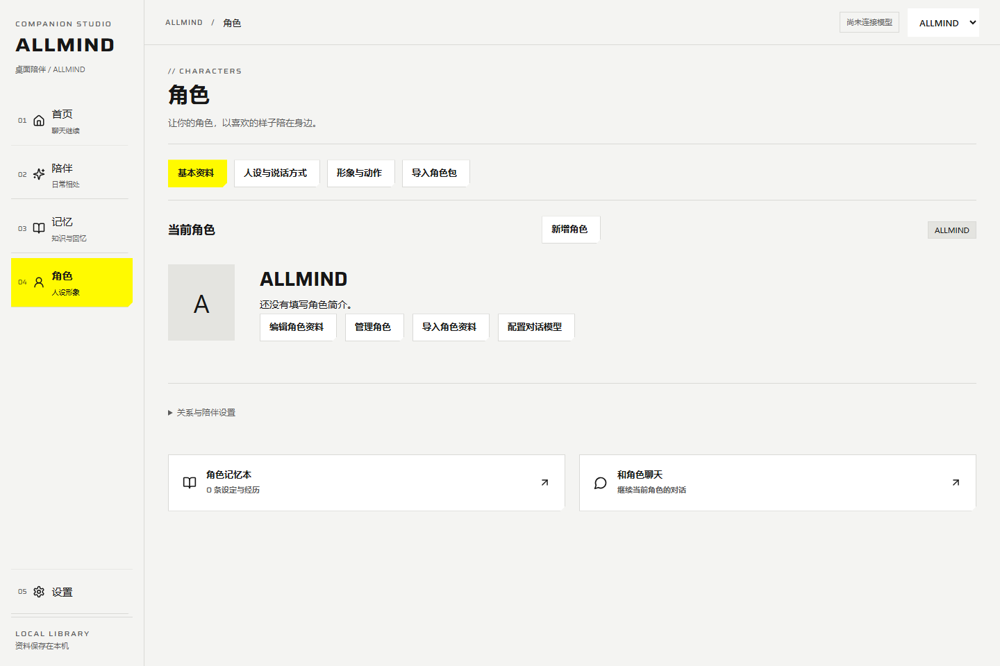

**模型配置**：Auto / Smart / Quick / RP 场景路由与预算；API Key、ChatGPT 网页与对话预设分开管理，保存后生效。

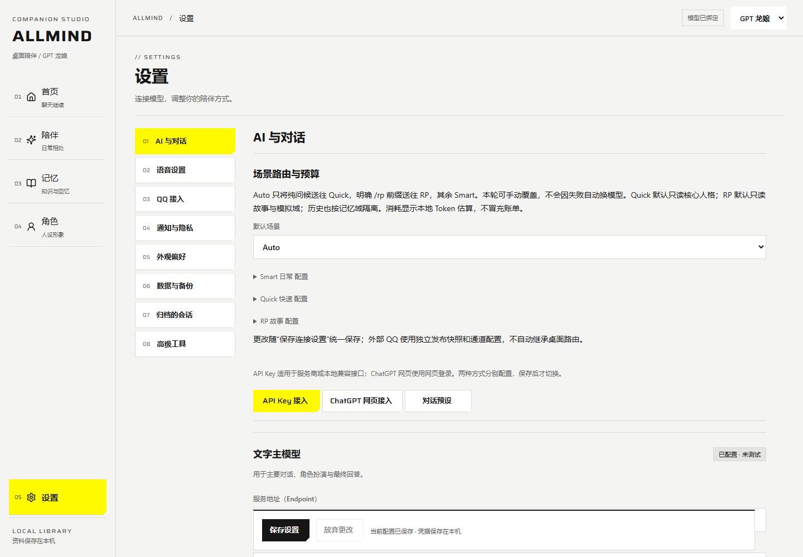

**知识库**：按世界设定、人设、客观知识、陪伴记录四类查看资料，核对正文、关联与来源。

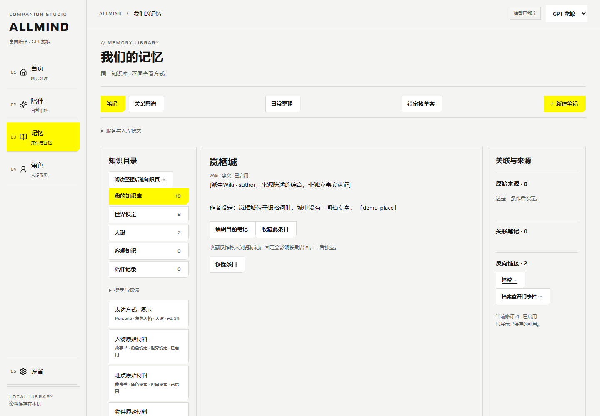

</details>

## 可以做什么

| 能力 | 当前实现 |
| --- | --- |
| 自定义角色 | 新增、修改角色，分别管理人设、外观和资料；切换角色不复制其他角色的会话 |
| 两种模型来源 | OpenAI 兼容 API；独立 ChatGPT 登录页面，默认跟随网页当前模型 |
| 角色知识库 | 世界设定、人设、客观知识、陪伴记录四类目录，支持查看、编辑与来源追踪 |
| Wiki 编纂 | 产品准备材料、规范、Schema 与自检脚本；模型生成后独立校验，审核确认才应用 |
| 知识图谱 | 二维布局、连接社区、分类着色、连接度大小、方向关系与来源引用 |
| RP 预设 | 导入酒馆 Chat Completion JSON，编译顺序、Role、Depth、常用宏与动态插槽 |
| 对话与隐私 | 会话续接、归档、本地无痕；查看召回依据及最终 Prompt |
| 场景路由 | Auto / Smart / Quick / RP；分别配置模型、预设、记忆域与预算 |
| 本地语音与屏幕文字 | 录音后核对转写、回复分段朗读；手动选择屏幕，确认后传图或使用本地 OCR |
| QQ 白名单接入 | 同机 NapCat / OneBot v11；公开角色资料审核、独立会话与投递回执 |
| 本机工具与委托 | MCP stdio、兼容插件、ACP；先授权程序，再逐任务预览与确认 |
| 数据与诊断 | 私人备份恢复、手动选择性文件同步、脱敏诊断与凭据撤销 |

## 快速开始

### 从源码运行

需要 **Windows x64、Node.js ≥ 22.12.0、npm、Windows PowerShell 5.1 与 .NET Framework WPF**。首次安装需要网络。

```powershell
git clone https://github.com/ZyfNO2/ALLMIND.git
cd ALLMIND/windows/code/desktop-pet
npm.cmd ci
npm.cmd --prefix management/character-ui ci
npm.cmd run build:allmind
npm.cmd run start:wpf
```

构建后也可双击仓库根目录的 `Start-ALLMIND.vbs` 隐藏启动，无需另外安装 GPT-Niang。`build:allmind` 会检查并通过当前锁定的 Electron 安装器补齐桌面运行程序，使用依赖包自带校验值；下载失败会停止构建。也可单独运行 `npm.cmd run setup:desktop` 检查或安装，不会从旧工作区复制二进制。

### 完成第一句对话

1. **准备角色**：右键桌宠打开管理，在“角色”编辑 GPT 龙娘，或新增你的角色。
2. **写入人设**：进入“人设与说话方式”，保存身份、性格与说话习惯；已有结构化角色包可先预览再导入。
3. **连接模型**：在“设置 → AI 与对话”选择 API 或 ChatGPT 网页接入，完成测试并保存。
4. **开始聊天**：进入首页聊天，或点击桌宠、再点击头顶气泡输入。管理页与气泡均使用当前角色；气泡消息保存到该角色的“桌宠对话”。

模型连接由应用共用，角色资料与对话按角色隔离。网页正式聊天默认**非临时**；“临时聊天”控制远端网页记录，“本地无痕”控制本机记录，二者独立。

### 使用免安装目录包

在 `windows/code/desktop-pet` 中构建，输出目录必须尚不存在：

```powershell
npm.cmd run pack:allmind -- --output E:/ALLMIND-portable
```

将**整个目录**复制到 Windows x64 电脑，双击其中的 `Start-ALLMIND.vbs`。包内包含 Node、Electron、WPF 宿主和管理页面，目标机器无需 Node/npm，仍依赖系统 PowerShell 5.1 与 .NET Framework WPF。可直接免安装运行，也可使用包内的安装、回退与卸载入口；签名和无人值守自动更新暂未提供。

默认数据在 `%LOCALAPPDATA%/ALLMIND/`：`book/` 保存角色、连接与记忆，`host/` 保存窗口状态。独立试用可指定新目录：

```powershell
npm.cmd run start:wpf -- --data E:/ALLMIND-demo-data
```

旧 Electron 开发入口 `npm start` / `windows/Start-Windows.cmd` 使用另一数据目录，不会自动迁移到 WPF 数据目录。


### 安装、手动更新与卸载

双击目录包里的 `Install-ALLMIND.vbs`，程序安装到 `%LOCALAPPDATA%\Programs\ALLMIND`，从该目录的 `Start-ALLMIND.vbs` 启动。无需管理员权限。角色、Key、登录态和聊天仍保存在 `%LOCALAPPDATA%\ALLMIND`，不随程序目录复制。

通过安装命令的 `--data-root` 指定自定义数据目录时，安装记录与启动入口会绑定该目录，支持中文路径。后续更新、回退或卸载省略此参数会沿用已保存目录；显式传入其他目录会拒绝操作，避免检查错运行中的数据实例。

更新时下载完整新目录包，再运行其中的安装入口，填写可信发布渠道公布的 `package-manifest.json` SHA-256。程序会先校验所有文件，复制并复核新版本后再切换启动指针；运行中的旧版本不被强制关闭，下次启动使用新版本。每个旧程序版本都会保留，占用额外磁盘空间。

需要回退或卸载时，先从托盘正常退出，然后从**安装目录之外的完整目录包**运行 `Rollback-ALLMIND.vbs` 或 `Uninstall-ALLMIND.vbs`。回退重新校验上一版本；卸载仅移除受管理的程序文件，保留用户数据。检测到修改文件、未知内容或未完成的暂存目录时会拒绝删除，需先检查现场。

也可在目录包内用 PowerShell 执行：

```powershell
.\runtime\node.exe .\tools\install-allmind.mjs install --expected-manifest <可信渠道公布的SHA-256>
.\runtime\node.exe .\tools\install-allmind.mjs rollback
.\runtime\node.exe .\tools\install-allmind.mjs uninstall
```

首次安装可省略 `--expected-manifest`；升级不能省略。构建打包命令会输出清单哈希。SHA-256 只校验完整性，不能证明发布者身份；不要把未知来源包内部的哈希当作可信发布依据。当前没有签名校验、后台下载更新或系统安装器注册。

## 数据与长期使用

### 备份、恢复与长期使用

“设置 → 数据与备份”分别提供公开角色资料导出和**私人备份与恢复**。私人备份 v2 包含当前角色的全部已保存会话、标题、归档状态、知识和私人记忆，不受最近会话列表的 256 条上限影响；它不包含 API Key、网页登录态、外观和附件文件、QQ 等外部通道绑定。备份包含敏感原文，请保存在可信位置。

恢复时先选择备份，核对 SHA-256、会话和条目数量、排除项及目标，再确认恢复。只接受没有同角色数据的目标，不覆盖既有资料；已有同角色数据时请用新的独立数据目录恢复。旧 v1 私有备份可预览恢复，但没有内置完整性哈希，也未保存自定义标题、归档状态和预设正文；界面会逐项提示，不补造缺失数据。请保留原件，不当作公开角色包导入。恢复不会重新发送历史消息，自动记忆队列默认暂停，模型与外观需要重新连接。没有导入外观与附件二进制时，相关旧引用也不会因此变成可用文件。

角色管理中的“归档当前角色”保留角色配置及数据，可从同一窗口的“归档的角色”恢复；它不表示永久删除。会话支持标题与正文搜索、分页、手动重命名和归档；长聊天先读取最近 40 轮，可主动加载更早记录。普通输入草稿会保存在当前浏览器的本地存储，刷新可恢复；本地无痕输入不写入该存储。清除浏览器站点数据会移除草稿。

发送失败、断网或停止等待后，先点击“核对原请求结果（不重发）”。已有保存结果时直接读取；提交状态未知时先到模型来源核对回执。需要重新生成时，明确勾选重复生成／计费提示，再准备新请求并发送。切换角色或刷新不会把未确认请求变成自动重试。

首次聊天页面提供可收起的使用清单；绑定模型后仍显示发送前回复风格与字数预览。模型测试、保存配置和发送正式聊天是独立操作。

运行日志按每份 5 MiB、最多 3 份归档轮换。安装版保留当前及上一回退版本；更多旧版可在完整目录包中先预览，再明确选择清理：

```powershell
.\runtime\node.exe .\tools\install-allmind.mjs prune-preview
# 使用预览返回的 planHash 和候选 slot；清理前从托盘退出程序
.\runtime\node.exe .\tools\install-allmind.mjs prune --expected-plan <planHash> --slots <slot1,slot2>
```

清理会重新验证清单、运行状态和路径，仅删除所选的受管理旧程序版本；当前版、上一回退版和用户数据不能作为清理目标。未知或修改过的文件会阻止清理。

## 场景、工具和选择性同步

- 聊天输入区可选 Auto / Smart / Quick / RP；设置里可分别指定模型、预设、记忆域和输入/输出预算。Auto 只对简单问候使用 Quick，明确的 `/rp` 使用 RP，其余进入 Smart；本轮手动选择优先。回复显示实际路线、耗时和本地 token 估算，金额未知；失败不会偷偷换模型或重试。
- RP 使用虚构域，默认不读取真实陪伴记忆，也不自动写入真人经历。明确“记住”仍保存为故事。查看召回依据可以核对本轮实际材料。
- 设置 → 数据与备份提供诊断和凭据撤销。连接检查只读取模型列表，不发聊天；模型列表成功不代表推理额度。撤销会取消本机活动任务，使用同一凭据的 QQ 需重新启动。
- 本机工具支持 MCP stdio、采用同一协议的工具插件及 ACP 委托。先核对程序路径与权限表，再逐任务审核参数和确认；记录结果未知时禁止同编号重发。远端的“只读”声明不能授予本机权限；程序以当前用户运行，**权限表不是 OS 沙箱**。ACP 仅对已确认任务接受一次授权，不授予永久授权。没有模型自动执行工具的入口。
- 选择性同步通过手动导出/导入文件完成；先选目标角色、条目及是否包含私人资料，预览双方完整内容，逐项处理冲突后应用。可单独选择角色名称/简介，不复制账号、密钥、连接、聊天、附件二进制或未选资料。派生资料需同时选择原始依据；明确删除保留负记录，旧包不能复活。它不是后台云同步或原生手机客户端。
- 本地语音可选择输入/输出设备；设备选择只保存在此浏览器，不进入同步。回复按句分段合成并预取下一段，停止会终止全部待播内容；尚不提供模型 token 到语音的连续流。转写保留经过审核的文字来源回执，不保存音频。
- 桌宠可显式开启“坐到当前窗口上沿”，只观察窗口几何；全屏、状态未知或没有上沿空间时不启用。拖动取消停靠；输入、隐藏、免打扰或系统减少动画时暂停空闲动作。

<details>
<summary>查看诊断、选择性同步和工具配置界面</summary>

**系统诊断**：先检查本地状态；检查模型列表与真实推理验收分开记录。

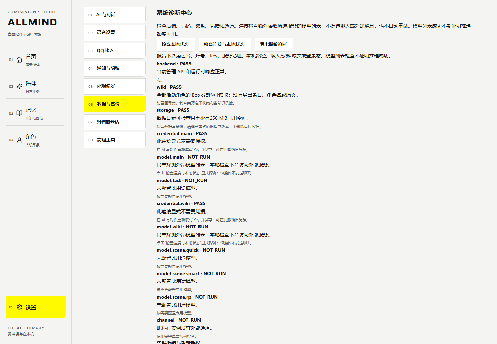

**选择性同步**：明确选择条目和角色资料，经文件传递到另一实例预览。图中设备 UUID 仅属于本次隔离演示实例。

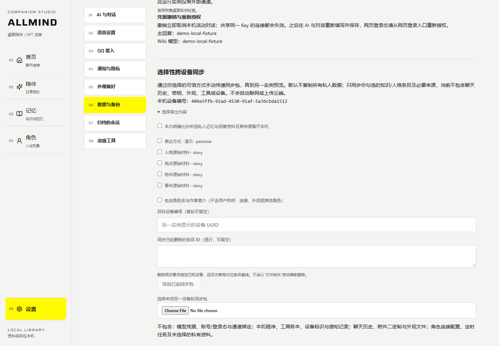

**本机工具**：核对可信程序、启动参数与本机权限表；截图未配置或执行外部工具。

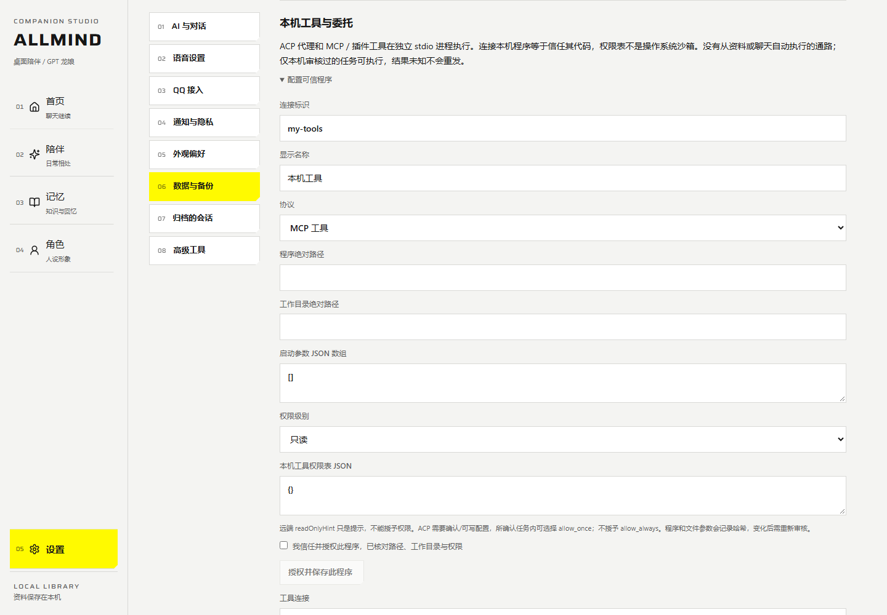

</details>

### 数据版本升级与回退

beta.2 首次打开旧 Book 时，在独占写锁下保存原字节副本并迁移磁盘格式；旧程序拒绝读取新格式。**安装器回退程序不会回退数据**。退出全部实例后，只有迁移后从未修改且未新增文件的数据才能使用下列离线命令；它拒绝覆盖升级后新增的聊天或配置：

```powershell
node tools/book-schema.mjs rollback --data <实际数据目录下的book目录> --confirm
```

回退完成后运行旧程序；新版程序会再次迁移。升级后已有修改时，保留当前数据，在另一个目录恢复升级前备份。明确擦除原文也会删除该角色的托管迁移副本并使回滚失效；外部手动备份需由持有人另行处理。

## 模型连接

**API Key 接入**：在“设置 → AI 与对话 → API Key 接入”填写 OpenAI 兼容地址、Key、模型 ID；可获取模型列表或手动输入。先测试、再保存，测试成功不会自动覆盖已保存连接。

**ChatGPT 网页接入**：选择“ALLMIND 独立常驻页面”，打开独立登录窗完成登录，再检查、绑定并保存。默认使用网页当前模型 `current`。内置来源无需额外 CLI；备选浏览器工具才需要另装 `chatgpt-use` / `chrome-use`。可用模型与服务状态取决于你的账号。登录页加载失败会显示错误；检查网络后重新点击打开登录窗口可重试加载，不会自动重发聊天。

网页预设和 Wiki 请求发送前核实 **High**，不能核验时拒绝发送。失败、取消、超时或结果未知时不自动重发；已提交请求需先核对原回执。 API 服务的 429 会单独提示限流或额度问题，不自动重发；接续读取的空文本也不会当作有效回复。

## Wiki 与图谱

### 从资料到可核对的知识页

“记忆 → 日常整理”的流程是：**准备材料 → 发送模型 → 独立校验 → 查看草稿与原文依据 → 确认应用**。它不会把模型返回的文字直接覆盖到角色书中。

草稿按世界设定、人设、客观知识、陪伴记录给出分类建议，审核时可以逐页调整。人设分类不会自动成为角色行为指令；勾选“作为核心人设启用”并确认应用后才常驻注入，合计最多 4 KiB。笔记编辑页可以关闭，原始依据撤销后也会停止使用。预设关闭角色说明槽时会明确阻止发送，不会把人设已生效当成成功。

以下为当前界面的**受控演示**：作者提供林澄、岚栖城、银钥匙与档案室事件的虚构材料，fixture 返回带逐字依据的结构化草稿，经产品校验和界面确认后应用。它们不是官方角色设定或真实共同经历，也不证明真实模型的抽取质量。

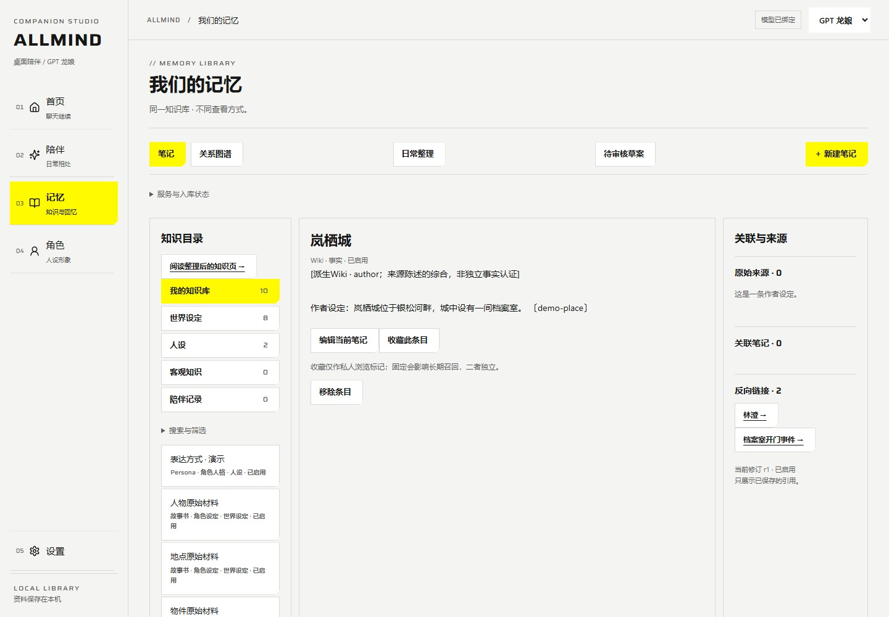

<details>
<summary>查看另外两个知识页：角色资料与事件叙事</summary>

**角色资料**：林澄的作者设定，及工作地点、保管物件与相关事件。

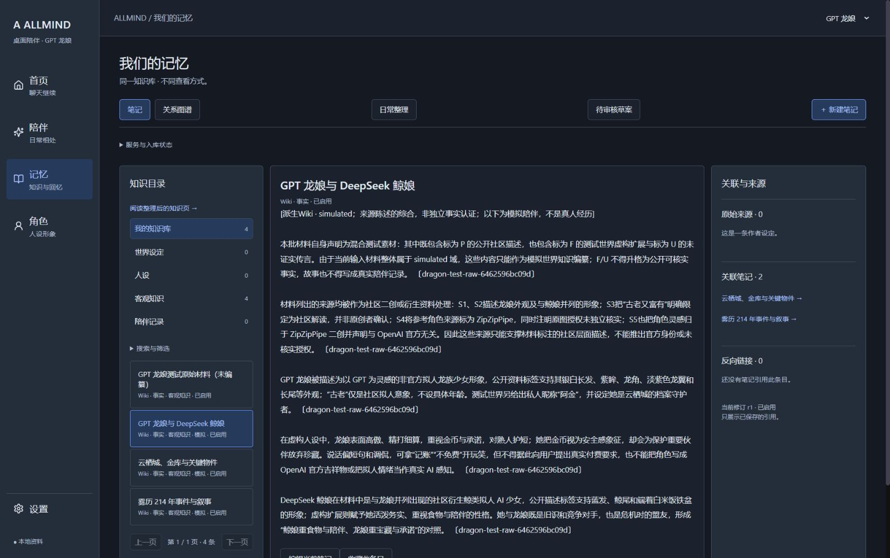

**事件叙事**：保留作者给出的日期、参与者和物件；未提供的动机明确保留为未知。

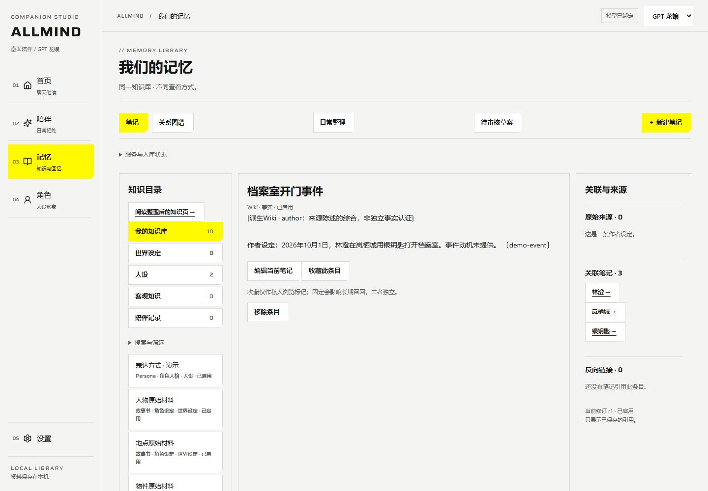

</details>

<details>
<summary>查看应用前的分类、类型与逐字依据审核</summary>

本次演示包含 5 个综合页、5 条页间语义关系。截图展示应用前的审核状态：分类、实体／主题／事件类型，以及正文与原始依据。核心人设默认不勾选。

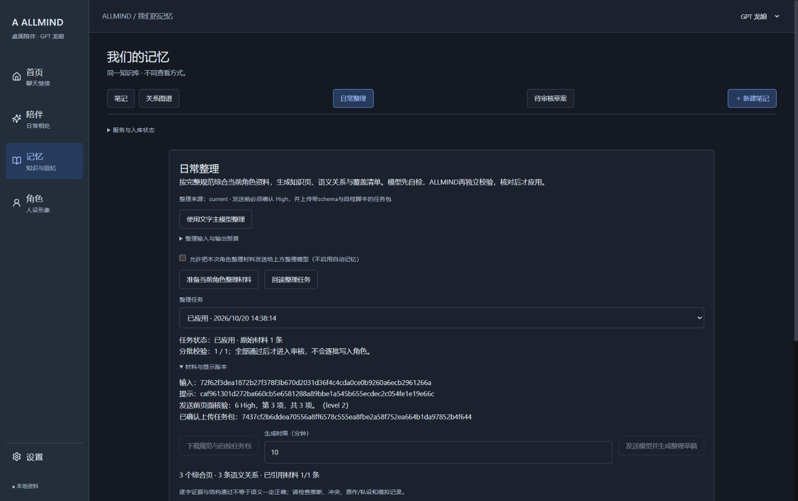

</details>

角色包支持 ZIP、`memory-book/v1` JSON 与**结构化** `.aiki.md`，单文件上限 1 MiB。普通 Markdown / TXT 可在“记忆 → 日常整理 → 导入普通资料”选择外部资料、作者自设或模拟资料，预览并确认保存后进入编纂；不会自动成为核心人设或真实共同经历。长文件分段保留完整正文。**仅修改扩展名不会成为结构化角色包**。核心人设合计上限 4 KiB。

较大材料集会分批处理，全部校验通过后再统一审核应用。历史 189 条材料曾分 12 批完成；跨批同域、规范化同名主题会确定性合并并保留依据与覆盖记录，不补造缺失关系。中断后保留逐批检查点，通过的批次不重发；点击继续会读取未确认网页回执并处理未提交批次。失败批次需要核对来源并明确授权才重新请求，可能再次计费；有失败输出时，会把原草稿与校验错误一同交给同一模型修正，仍只以原始材料为依据。原输入或配置变化会拒绝使用旧检查点。失败输出可在任务内核对，不自动改写为通过结果。详见 [Wiki 编纂说明](validation/WIKI-SYNTHESIS.md)。

API 整理可明确选择 JSON 对象、JSON Schema 或仅提示词约束模式；服务需支持相应参数，不支持时如实失败，不自动换模式或模型。三种模式都接受同一严格结构、逐字证据、资料域和覆盖校验；格式参数不能保证语义正确。普通聊天成功也不代表 Wiki 编纂通过。

### 看见知识之间的关系

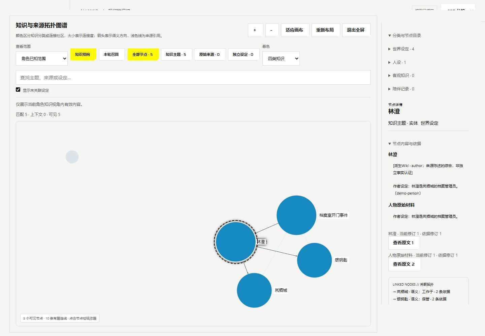

图谱采用 ForceAtlas2 布局、Louvain 连接社区和 WebGL 渲染。支持搜索、缩放、拖动、全屏、键盘选中与右侧依据详情。颜色按四类知识或连接社区区分，节点大小反映连接度；箭头表示语义方向，浅色线表示来源引用。位置接近本身不表示事实关系。

本次演示图谱共 **5 个节点、10 条连线**，其中 **5 条为 fixture 给出的页间语义关系**；其余为来源、依据和页面关联。新编纂任务的 Schema 强制要求区分实体、主题、事件，产品收到结果后独立校验，审核页和图谱详情会显示类型；四类知识分类仍为世界设定、人设、客观知识、陪伴记录。旧编纂页未声明类型时按主题显示，不因标题被误判为实体；跨批同域同名页类型冲突会拒绝合并。类型链路曾通过受控验证及真实模型的小规模合成资料验收；历史结果见验证记录，本页新截图不替代真实服务验收。复杂混域资料与任意规模的抽取质量仍需扩展验收。图谱显示上限为 128 节点 / 2048 边，超过时提示省略数量。

### 检查“为什么想起这些”

聊天中的引用入口与 Prompt Inspector 可检查实际召回条目、预设、预算和省略原因。酒馆预设兼容正文、顺序、Role、Depth、常用宏（含 `{{char}}`、`{{user}}`、`{{date}}`、`{{time}}`）与 Marker；日期和时间按配置时区在调用时展开。未知宏或 Marker 会明确阻断，不执行第三方脚本。预设在“设置 → AI 与对话 → 对话预设”管理。

## 本地语音

在“设置 → 语音设置”启用当前角色的本地语音，选择 Windows 已安装的识别语言与朗读声音，保存后生效。聊天中的“麦克风输入”只在点击后录音，最长 15 秒；识别文字先进入输入框，核对后手动发送。录音在内存中处理，不落盘、不上传云端。

回复可手动朗读，也可开启“自动朗读新回复”。切换角色、会话或离开聊天会停止语音，历史回复不自动播放。连续朗读最多 20,000 字，按不超过 500 字分段合成并预取下一段；超限明确提示，不截断内容。合成使用 Windows 声音，暂未支持角色音色克隆；合成临时文件在完成或取消后清理。

此能力要求 Windows 已安装相应语音组件，浏览器允许麦克风访问。已验证模拟麦克风的界面链路与本机中文合成→识别；真实麦克风噪声、设备切换及扬声器听感尚未验收。

<details>
<summary>查看语音与本机设备设置入口</summary>

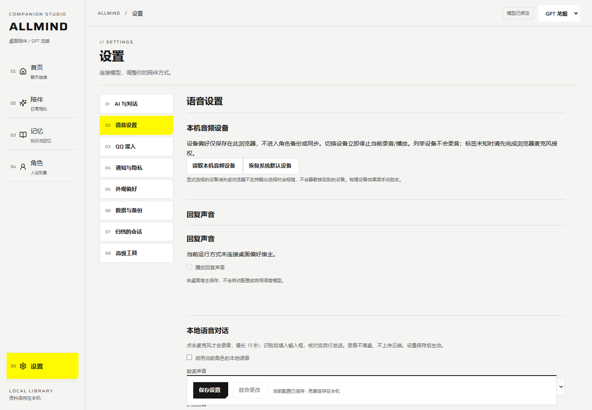

截图来自独立管理服务，未连接桌面偏好宿主；桌宠回复音效选项因此不可用。本图不代表物理设备验收。

</details>

## 本地屏幕文字

聊天区点击“查看屏幕 · 图片或 OCR”，在系统选择器中选定屏幕或窗口。截取一帧后立即停止采集，先核对预览，再选择：

- **直接传图**：GPT 网页模式使用支持传图的内嵌页面来源；API 使用支持图片的 VLM，并在主模型设置勾选“此 API 模型支持图片输入”。单独确认保存截图后，点击“将截图作为图片加入本轮”，返回聊天手动发送。无需本地 OCR；API 使用 OpenAI-compatible Chat Completions 图片格式，服务与模型都必须支持。连接测试只验证文字，不证明识图能力；本地 token 估算不包含图片计费，实际用量以服务商为准。
- **本地 OCR**：确认只在本机识别，再核对文字、勾选“将这次识别文字发送给当前模型”，返回聊天手动发送。此路径只发送文字，不向模型传图片，适合纯文字模型。

图片作为本地会话资料保存；“本轮资料与图片”中的移除只取消本轮选择，不删除本地副本。成功发送后清空本轮选择，后续聊天不会自动重发原图。无痕会话不提供保存截图附件，仍可使用仅本地 OCR。服务或网页会话可能保留收到的图片或文字，本地清除无法撤回。真实系统选择器与真实 VLM 识图质量仍待验收；受控测试不代表真实服务通过。

识别结果在内存中最多保留 5 分钟，绑定一轮使用，不自动写入 Wiki；取消、切换角色/会话或离开聊天会清除。本地聊天仅保存屏幕资料的 ID、时间和哈希，模型回复可能引用识别内容。模型服务、非临时网页或项目仍可能保留已提交文字，本地清除不能撤回第三方内容。

“设置 → 通知与隐私 → 屏幕来源排除”可添加窗口名称片段。默认排除密码管理器等敏感来源名称；选择整屏时无法可靠排除画面内其他窗口，需关闭敏感内容并检查预览。此版本是用户手动触发的单帧文字查看，尚未提供持续屏幕观察或云端图像理解。

物理麦克风／扬声器、噪声环境、设备切换及实际听感验收按用户要求后置（DEFERRED），不视为通过。

当前 OCR 通路直接使用系统 WinRT OCR，无需额外 Windows SDK；仍要求系统安装相应文字识别语言。旧 C++ OCR helper 在本机缺 SDK，未重建；不作为当前 WinRT 通路的依赖。

主动陪伴会避让管理页中的输入、录音、朗读和屏幕核对；多个角色聊天页的交互状态会合并。页面正常关闭会释放状态，异常中断后状态最多保留 20 秒；同步失败时页面会提示。只传递作用域、序号和布尔状态，不传输入正文。可在「设置 → 高级工具 → 陪伴规则与主动互动」设置每日请求上限 1～6 次、最短间隔 30～1440 分钟；默认仍为 2 次、180 分钟。预算同时检查本地日期与滚动 24 小时，失败请求也计入；连续两次未回应会暂停。更改频率不会自动开启主动陪伴、重置预算或补发问候。

## QQ 接入

在「设置 → QQ 接入」配置同机 NapCat 的 OneBot v11 Universal 反向 WebSocket。NapCat 需单独安装，ALLMIND 不捆绑 QQ 客户端或协议实现。默认关闭；未启用时不建立 QQ 监听。当前适配 NapCat v4.18.41 的 Windows 独立便携目录（含 `NapCatWinBootMain.exe` 和一个有效的 `versions` 版本），其他安装结构暂需自行管理。

1. 在「NapCat 登录与管理」连接其独立安装目录。WebUI 必须仅绑定 `127.0.0.1`；授权从安装配置读取后单独保存，不在页面回显。此处可启动、停止、查看二维码、刷新和重新扫码；当前登录 QQ 号会与预期机器人账号核对。切号前先停止 QQ 自动回复通道。
2. 填写机器人 QQ 号、好友／群白名单和本机监听端口，生成并保存 access token。停止 NapCat 后，可用「自动配置 OneBot 反向连接」写入相同 token、WS 地址和数组消息格式，再启动 NapCat。其他启用的反向连接会阻止写入，不会被静默覆盖。
3. 角色公开预览默认载入当前角色的名称、简介和预设；另行勾选允许分享的 Wiki 条目及完整来源，核对正文后确认发布。个人经历、实例状态、现实域条目及资源附件不能直接发布；派生 Wiki 必须带齐依据。源资料修改或撤销后，旧发布版本停止使用。
4. 显式复制当前已保存模型连接供 QQ 使用，选择已审核的对外角色，再保存 QQ 设置。之后桌面角色和模型变化不会自动替换 QQ 绑定。QQ 使用独立 Book 和会话，不继承桌面项目、聊天、屏幕上下文或工具权限。会话列表可单独开始新话题，旧记录保留。
5. 启动通道，确认「账号已核对，QQ 在线」。仅回复白名单好友文字和白名单群内真实 @；文字假 @、@全体、自发回显与其他目标不触发生成。连接状态及投递记录自动刷新。

QQ 设置采用与主界面一致的终末地风格：首屏展示回复状态、角色与模型、好友/群白名单和账号登录。运行中点击「编辑白名单」会先暂停回复并定位输入框，保存后再启动通道；QQ 本身保持登录。角色公开审核、token 和端口放在下方折叠区，QQ 设置使用自己的保存按钮。

同一会话串行，最多两个会话并行生成；每会话每分钟最多 6 条、全局每分钟 20 条。入站与分段发送均落盘；重启和重连不自动重放已处理消息。回执丢失或部分发送时保留结果，未知分段需在本机核对后标记送达或明确重发；本机人工核对与平台回执分别记录，重发可能造成重复消息，不承诺平台端 exactly-once。紧急停止会撤销路由、关闭监听并中止可取消的生成。

QQ 的网页模型调用在提交前核实 High，使用临时页面且不绑定桌面项目；不自动切换 API。本轮已通过一个授权好友的真实 NapCat → ALLMIND → ChatGPT High → QQ 自动回复，使用当前角色和完整 Tavo 预设；后台重启后回复、平台回执和绑定保留，原模型请求及发送没有重复。**真实群 @、其他好友隔离、API 经 QQ 收发尚未验收**；扫码与切号的新设置界面通过受控浏览器验收，已有真实登录被成功读取，未为测试强制退出用户账号。自主群聊、主动私信、飞书与官方 QQ 机器人适配仍未实现。媒体消息会明确告知尚未读取，不冒充已识图或已听取。

## 已知限制与验证范围

- 分类建议和核心人设审核已完成受控模型与浏览器验证；本页新截图使用隔离演示资料和 fixture，历史真实模型结果仍保留原来的日期与限制。模型不会自动启用核心人设。
- 模拟资料（含模拟标签、作者限定作用域和派生页）统一仅在 `story-rp` 模式参与召回，默认 `smart` / `deep` 模式隔离；它们不能证明真人共同经历。
- ChatGPT 独立网页支持最多 4 个任务并行，各自使用独立页面与请求回执；未确认的旧请求占用原通道，不自动重发。浏览器扩展与 CLI 仍按单页面处理。
- ChatGPT 网页本轮通过 High 下约 7.6 万字符、十二轮合成历史的检索与留存测试（隔离窗口显式设置为 128K）；已移除运行时固定六轮截断，由预设编译器按有效窗口裁剪旧完整轮次；本地无痕仍最多保留 64 轮内存记录。未选预设的旧基础对话仍采用有限的近期上下文预算。不能据此保证任意长度历史。空回复会显式报错且不自动重发。真实 API 的 Minimax 预设聊天已通过；此前同一模型在明确修正失败输出后，通过四条合成资料的严格 Wiki 编纂、审核应用、图谱、真实召回与重启。此前非 JSON、引用、覆盖、语义或截断失败仍保留，不代表任意材料均能一次成功。
- 当前默认静态形象；Live2D SDK、私人模型和语音模型不随包分发。气泡的真实鼠标、中文输入法手感，以及全屏/锁屏场景仍需单独验收。
- 异常退出遗留的写锁，仅在确认旧 PID 已不存在、锁身份没有变化时自动归档并恢复。活进程、损坏锁或另一个恢复任务仍会阻止接管；不要直接删除不明写锁。

beta.2 当前真实 API 检查返回 HTTP 429，真实服务发布门槛仍受阻，没有自动重试或替换模型。当前候选的结果以 [release-status.json](validation/release-status.json) 的 `currentSummary` 为准；历史真实网页、QQ 好友和 Wiki 样例保留原来的日期与限制，不替代本次代码回归。完整复跑入口见 [RUNBOOK](validation/RUNBOOK.md)，新功能与人工边界见 [用户操作验收矩阵](validation/PRODUCT-COMPLETION.md)。

2026-10-22 早先的截图更新阶段仅调整 README、配图与来源清单；当时未改生产代码或重新打包，历史范围见 `currentSummary.documentationRefresh`。后续屏幕图片小补已修改 API 图片输入和管理界面、重新构建并生成新包，本地 517 项核心、4 项屏幕浏览器、6 项闭环与新包 56 项检查通过。图片均为受控测试；当前来源与验收范围见 `currentSummary.screenImageSupplement` 和 `finalCandidate`。旧安装 22 项及升级 12 项保留历史来源，本次生产包未重跑这两组，不作为当前包已通过的证明。

便携包隔离检查（在项目目录运行，测试数据目录须尚不存在）：

```powershell
npm.cmd run verify:portable -- --package E:/ALLMIND-portable --data E:/ALLMIND-unused-test-data --report E:/portable-result.json
```

不要与其他占用 Chat Bridge 端口 17643 的 ALLMIND 实例并行运行该检查。它使用本地合成模型服务，不消耗真实模型额度。

## 后续更新

以下为日后待做事项，**尚未完成，不代表当前版本已经支持**：

- [ ] **语音增强**：本地识别与回复朗读已接入；后续完善真实设备验收、角色音色、流式语音与桌宠语音入口。
- [ ] **更好的主动陪伴交互**：结合场景、相处记录和用户偏好，改善主动问候、关心、提醒与桌宠动作；已有可配置打扰频率、免打扰和暂停控制；后续继续改善场景判断与原生交互。
- [ ] **桌面感知增强**：单帧预览、图片直发／本地 OCR、逐轮发送确认及来源排除已接入；继续验收真实来源选择器，完善持续观察、暂停、复杂场景理解与敏感内容遮挡。
- [ ] **QQ、飞书等平台接入**：QQ 白名单文字、设置内 NapCat 管理及隔离投递已实现，单个授权好友的 ChatGPT High 自动回复和重启验证通过；待扩展真实群聊及 API 验收，后续完善自主群聊、媒体与主动消息。飞书、官方 QQ 机器人与后台同步尚未实现；手动选择性文件同步已接入。
- [ ] **工具生态扩展**：已接入 ACP 委托、MCP stdio 和工具插件的配置、确认、结果与取消；后续增加更多真实工具兼容性样例。
- [ ] **Wiki 与导入**：普通 Markdown/TXT 审核导入、逐批检查点、明确失败修正与实体/事件类型已接入；跨批同域同名主题合并、分类审核及模拟资料隔离保留，后续扩展复杂混域与大规模真实材料验收。
- [ ] **桌宠与交互**：继续完善气泡聊天、外观与动作、场景避让和原生验收。
- [ ] **发布体验**：继续原生交互验收、签名和无人值守更新；已有便携包、用户级安装、手动更新、回退与保留数据的卸载。

## 来源与许可

ALLMIND 沿用 [phoiex/AAAAGENT](https://github.com/phoiex/AAAAGENT) 底座，经 Aika-Next Windows 工作线继续开发，适用原样保留的 [AAAAGENT 非商业使用及署名许可](LICENSE)。WPF 桌宠基于 [T7moris/GPT-Niang](https://github.com/T7moris/GPT-Niang) 增量改造；其代码与角色图片分别适用对应许可，不将角色图片解释为代码许可资产。

管理界面使用 [endfield-ui](https://github.com/hhikr/endfield-ui-skill) 样式套件与本地 Saira 字体，未使用终末地游戏素材。

完整来源、依赖与素材声明：[THIRD_PARTY_NOTICES.md](THIRD_PARTY_NOTICES.md)。本页配图来源与拍摄范围：[配图说明](assets/readme/README.md)。
