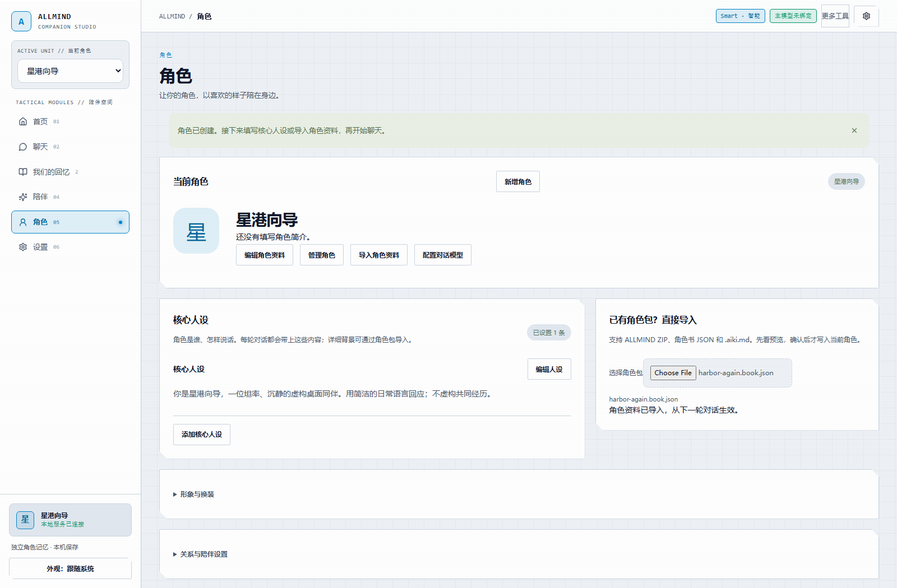
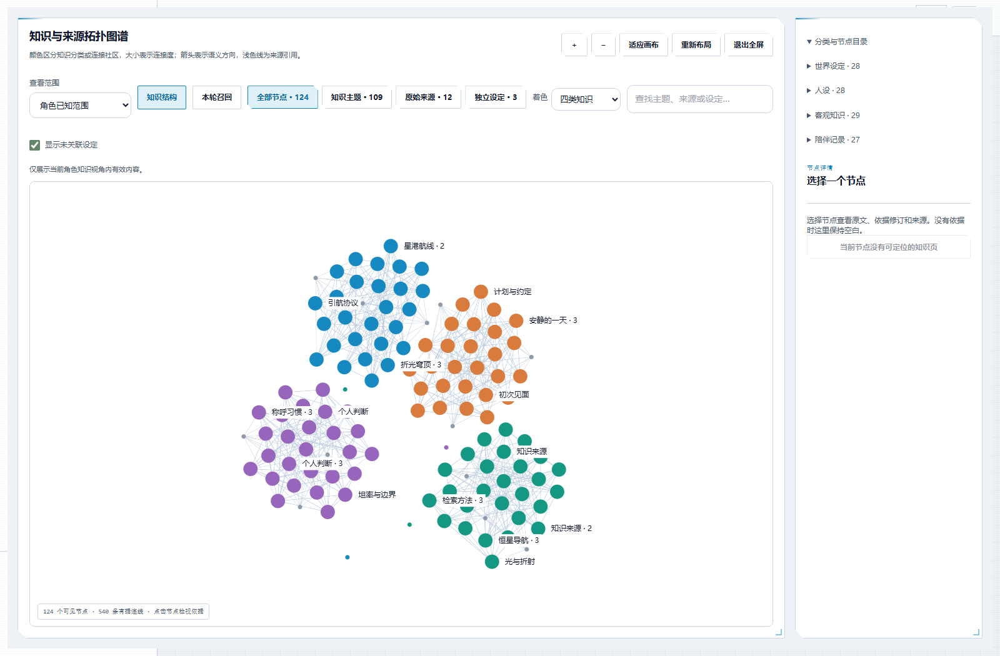
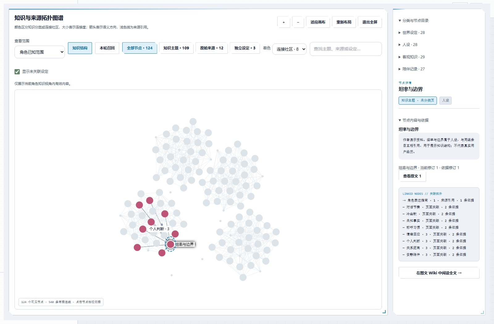
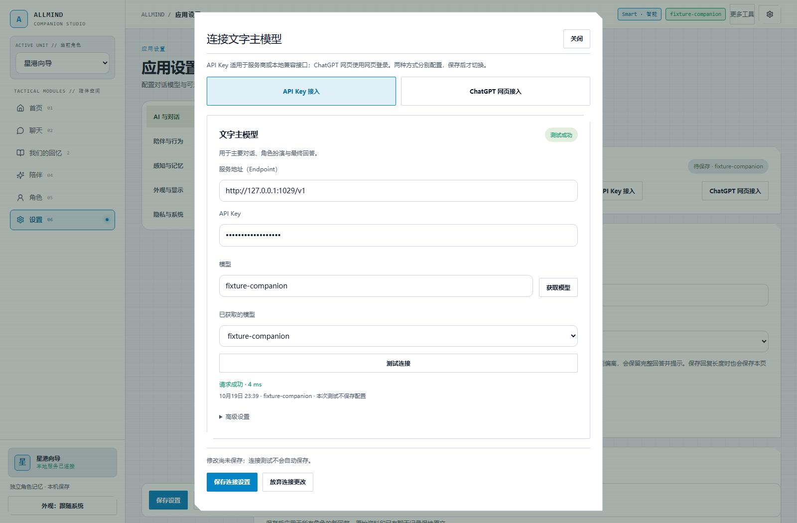

# ALLMIND

Windows 桌面角色陪伴与本地知识管理 Beta。创建你的角色，写入人设或导入角色包，连接模型后开始聊天；角色资料、Wiki 与对话记录保存在本机。

**0.1.0-beta.1 · 源码预览版**。目前提供源码构建，不提供安装器。首次启动是空白角色，不附带私人角色、Key、登录态或聊天历史。

## 从空白到第一句对话

1. **准备角色**：首页点“设置角色与人设”，在角色页直接编辑当前角色，或点“新增角色”。
2. **写入设定**：在“核心人设”写下身份、性格和说话习惯并保存；已有角色包可直接在旁边的“导入角色包”选择文件，预览后确认应用。
3. **连接模型**：点“配置对话模型”。API 路径填写服务地址、Key 和模型，获取模型或手动输入 → 测试连接 → 保存连接设置。测试不会自动保存；失败后输入仍保留。
4. **开始聊天**：保存连接后点“开始对话”。之后在“我们的回忆”查看、修改资料与核对召回来源。

编辑角色与导入资料只影响当前角色；模型连接由应用共用。形象、换装、关系与陪伴设置默认收起，之后需要时再展开。

## 界面预览

以下是 **2026-10-19 隔离实例的真实产品界面**，不是设计稿。角色和图谱使用人工编写的合成演示资料；连接使用本机 HTTP fixture 模型。这些截图展示操作与渲染效果，不代表真实模型效果，演示数据不会自动导入。



*角色页直接编辑名称、介绍与核心人设，导入角色包无需进入高级工具。*



*124 节点、540 条已有依据连线的合成图谱。二维力导向布局，四类知识着色；也可切换为连接社区着色。*



*选中节点后突出直接邻居，在右侧核对正文和来源；布局聚类不会产生新的知识关系。*



*服务地址、Key 与模型直接可编辑；测试结果和未保存状态分别显示，低频参数放在高级设置。图中服务为本机合成测试服务。*

## 安装与运行

环境：Windows，Node.js **>=22.12.0** 与 npm。首次安装需要网络。以下命令从仓库根目录执行：

```powershell
cd windows/code/desktop-pet
npm.cmd ci
npm.cmd --prefix management/character-ui ci
npm.cmd run build
npm.cmd run build:desktop
npm.cmd start
```

也可双击 `windows/Start-Windows.cmd` 完成安装、构建与启动。若 npm 跳过 Electron 的安装脚本，且 `node_modules/electron/dist/electron.exe` 缺失，补跑 `node node_modules/electron/install.js`。

默认数据目录是 `windows/.local/memory-book/`。需要独立试用时，在启动前指定一个新目录：

```powershell
$env:AIKI_BOOK_DATA = Join-Path $env:TEMP ("allmind-demo-" + [guid]::NewGuid().ToString('N'))
npm.cmd start
```

首次打开管理界面且模型未配置时，首页会显示准备步骤。右键桌宠可打开管理界面。关闭窗口或“收起到系统托盘”会保留后台，托盘右键“退出 ALLMIND”才真正退出。

## 两种模型连接

- **API Key 接入**：使用服务商提供的 OpenAI 兼容服务地址、Key 和模型 ID。支持获取模型，也可手动填写。连接测试不写入配置，确认后保存才生效。
- **ChatGPT 网页接入**：在“设置 → AI 与对话”打开网页接入，选择“ALLMIND 独立常驻页面”，在独立登录窗口完成登录，再检查并绑定、测试和保存。默认跟随网页当前模型（`current`）。内置来源无需额外 CLI；只有备选浏览器自动化工具才需要另装 `chatgpt-use` / `chrome-use`。

网页预设与 Wiki 请求发送前会核实 High，无法核验时拒绝发送。账号、模型权限与服务可用性取决于实际服务。**本轮 API 交互用 fixture 验证；真实 API 服务此前返回 HTTP 403，仍为 DEFERRED。**

## 角色、资料与预设

- **角色包**：角色页可导入 ZIP、Book JSON 或 `.aiki.md`，单文件上限 1 MiB。选择文件先预览，确认目标角色、条目和冲突后再应用。诊断不通过时禁止应用；取消预览不写入。
- **核心人设**：支持直接编辑已有条目和增加条目，启用的人设合计上限 4 KiB。离开未保存的编辑会提示；导入包不会抹掉角色已有的其他资料。
- **四类资料**：世界设定、人设、客观知识、陪伴记录。角色知情范围同时作用于管理视图与召回；导入的模拟故事不等于用户真实经历。
- **酒馆预设**：设置 → AI 与对话 → 对话预设。支持 Chat Completion JSON 的顺序、Role、Depth、常用宏与动态 Marker；不执行第三方脚本。未知宏或 Marker 明确阻断。随树 Nano Bear 样例仅供手动选择，见 [第三方声明](THIRD_PARTY_NOTICES.md)。
- **本地 GPT 娘**：支持草案角色包，以及本地 GPT-Niang 静态图片和额度快照读取。入口在“角色 → 形象与换装面板”，不提供原挂件完整行为迁移；见 [适配范围](validation/GPT-NIANG.md)。

更多资料导入、导出与维护位于“我们的回忆 → 编纂与高级工具”。

## Wiki、图谱与召回

AI Wiki 编纂由 ALLMIND 准备材料和完整提示词，调用所选模型，再独立校验结构、逐字证据、资料域、关系端点与覆盖清单。**生成草稿后还要审核并明确应用**，才会更新角色资料。

单次输出有上限，因此较大材料集会自动分批。历史真实网页验收中，189 条材料分 12 批约用 24 分钟；第一次任务因证据不符失败，另建任务后通过。跨批同名主题未自动合并，中断不保存可续算的部分正文，也不会自动重发。限制与步骤见 [Wiki 编纂](validation/WIKI-SYNTHESIS.md)。

图谱采用 ForceAtlas2 二维布局、Louvain 连接社区与 WebGL 渲染。颜色可按四类知识或连接社区区分，大小反映连接度；箭头表示有据语义方向，浅色线表示来源引用。支持搜索、缩放、拖动、全屏、键盘选中与右侧依据详情。**视觉接近不代表事实关系**。最多显示 128 节点 / 2048 边，超出部分明确显示省略数量。

聊天侧的“为什么想起这些？”和 Prompt Inspector 可检查实际装配内容、预设、预算、生效参数及省略原因，区分编译预览与模型请求已完成。无痕会话不持久化聊天和记忆，但所选模型仍会收到请求内容。

## Beta 边界与验证

| 项目 | 当前记录 |
| --- | --- |
| 构建 / 本地核心 | 构建通过；L1 **392/392**，生产模块与合成数据 |
| 固定浏览器回归 | **28/28**（18 个文件）；包含从空白创建角色、人设、导入、API 测试/保存、聊天及角色隔离 |
| 图谱交互 | 124 节点合成图实际渲染、社区着色、节点检查、全屏退出及 390/320 px 布局通过 |
| 真实网页模型 | 先前有 High、预设聊天及分批 Wiki 记录；本轮 UI 改动未重跑真实服务 |
| 真实 API | **DEFERRED**：此前服务 HTTP 403；fixture 不替代真实服务验收 |
| 网页长期历史 | **未通过**：默认窗口会显式省略旧轮次，调大窗口后曾返回空回复；产品报错，不冒充成功 |
| 桌宠原生操作 / Live2D / 语音 | 本轮未验收；源码包不分发私人模型或 Cubism SDK，默认静态形象 |
| 安装器 / 签名 / 自动更新 | 暂不提供 |

失败、取消、超时或结果未知的请求保留提交意图，不自动重发；写入意图失败时拒绝发送。详细限制与历次首错分别保留在验证记录中。

复跑命令：[RUNBOOK](validation/RUNBOOK.md)；固定选择：[CASES.json](validation/CASES.json)；本轮交互范围：[UX-GRAPH.md](validation/UX-GRAPH.md)；完整历史：[release-status.json](validation/release-status.json)；当前源码哈希：[source-manifest.json](validation/source-manifest.json)。本轮修复已整理到唯一的 `Init` 提交；未做新的全量冷安装复现。以前的冷复现结果不能代替当前改动的冷复现。

## 来源与许可

ALLMIND 从 AAAAGENT / Aika-Next Windows 工作线整理并继续开发，沿用 [phoiex/AAAAGENT](https://github.com/phoiex/AAAAGENT) 底座及贡献者代码，适用原样保留的 [AAAAGENT 非商业使用及署名许可](LICENSE)。来源链、第三方依赖与素材声明见 [THIRD_PARTY_NOTICES.md](THIRD_PARTY_NOTICES.md)。
